# 使命召唤游戏助手的设计与实现pzbe0--论文

> 🎓 **计算机毕业设计 · 使命召唤游戏助手的设计与实现pzbe0--论文**
>
> 本仓库只放**项目介绍 + 运行截图**（截图是站点带水印的原图，存在仓库 `images/` 里）。
>
> 👉 **完整可运行源码 / 数据库脚本 / 部署文档：[点我获取](https://geekcode.top/archives/%E4%BD%BF%E5%91%BD%E5%8F%AC%E5%94%A4%E6%B8%B8%E6%88%8F%E5%8A%A9%E6%89%8B%E7%9A%84%E8%AE%BE%E8%AE%A1%E4%B8%8E%E5%AE%9E%E7%8E%B0pzbe0-%E8%AE%BA%E6%96%87?utm_source=github)**
>
> 💬 咨询微信：**ir9372**　|　🌐 更多项目：[极客代码 geekcode.top](https://geekcode.top/?utm_source=github)
>
> 📌 项目详情页：<https://geekcode.top/archives/%E4%BD%BF%E5%91%BD%E5%8F%AC%E5%94%A4%E6%B8%B8%E6%88%8F%E5%8A%A9%E6%89%8B%E7%9A%84%E8%AE%BE%E8%AE%A1%E4%B8%8E%E5%AE%9E%E7%8E%B0pzbe0-%E8%AE%BA%E6%96%87?utm_source=github>

<table><td width="230" align="center"> <b>扫码加微信 ir9372</b></td><td valign="middle">📦 源码 = 项目介绍 + 全部运行截图 + 数据库 + 部署文档 👉 点上方任意截图，直接跳到 <b>极客代码 geekcode.top</b> 详情页</td></table>

---

<h1>使命召唤游戏助手的设计与实现_pzbe0--论文</h1>
<h2>项目概述</h2>

本项目旨在设计与实现一款专为《使命召唤》游戏玩家打造的综合辅助平台，核心目标是解决玩家在道具获取、战绩管理及水平评估方面的信息不对称问题。系统采用前后端分离架构，后端基于 Spring Boot 构建稳定高效的服务接口，前端通过微信小程序提供移动端便捷访问体验，并配套 Web 后台管理系统供管理员进行数据维护。

适用场景涵盖玩家日常查询游戏资讯、管理个人战绩、浏览游戏道具分类以及查看水平评估结果；同时支持管理员对基础数据（如游戏分类、道具种类、新闻资讯等）进行增删改查操作。技术架构上，利用 MyBatis-Plus 简化持久层开发，Shiro 框架保障系统安全性，MySQL 存储业务数据，整体设计兼顾了用户体验的流畅性与后台管理的规范性。

<h2>技术架构</h2>
<h3>总体架构</h3>

本项目采用经典的 B/S 架构模式，分为表现层、业务逻辑层和数据访问层。

<ol>
<li><strong>表现层</strong>：包含微信小程序端（面向普通用户及管理端功能入口）和 Web 管理后台（面向超级管理员）。小程序端负责展示游戏资讯、道具列表、战绩信息等动态内容；Web 后台负责全局配置及数据管理。</li>
<li><strong>业务逻辑层</strong>：基于 Spring Boot 框架，集成 Shiro 安全框架处理身份认证与授权，使用 Controller 层接收请求并调用 Service 层完成具体业务逻辑，如玩家信息管理、道具分类维护、水平评估计算等。</li>
<li><strong>数据访问层</strong>：采用 MyBatis-Plus 作为 ORM 框架，配合 MySQL 数据库实现数据的持久化存储。MyBatis-Plus 提供了通用的 CRUD 操作接口，大幅减少了样板代码的开发量。</li>
</ol>
<h3>核心技术选型理由</h3>
<ul>
<li><strong>Spring Boot</strong>: 提供“约定优于配置”的开发体验，快速搭建微服务或单体应用，内置 Tomcat 容器便于部署。</li>
<li><strong>MyBatis-Plus</strong>: 在 MyBatis 基础上增强，支持 Lambda 表达式构建查询条件，具备分页插件和乐观锁插件，适合本项目的数据管理需求。</li>
<li><strong>Apache Shiro</strong>: 轻量级且强大的 Java 安全框架，易于集成到 Spring Boot 中，用于实现后台管理员登录验证及权限控制，确保只有授权人员才能访问敏感的管理接口。</li>
<li><strong>MySQL</strong>: 成熟的关系型数据库，能够很好地支撑玩家信息、战绩记录、道具元数据等结构化数据的存储与关联查询。</li>
</ul>
<h3>数据库设计要点</h3>

根据路由和功能模块推断，数据库主要包含以下核心实体表：

<ul>
<li><strong>用户/玩家表 (Wanjia/Users)</strong>: 存储注册玩家的账号信息及基本资料。</li>
<li><strong>游戏资讯表 (News)</strong>: 存储新闻标题、内容、发布时间及封面图。</li>
<li><strong>游戏分类表 (Youxifenlei)</strong>: 定义游戏的不同类别标签。</li>
<li><strong>道具种类表 (Daojuzhonglei)</strong>: 管理游戏中各类道具的分类属性。</li>
<li><strong>游戏道具表 (Youxidaoju)</strong>: 存储具体道具的名称、描述、所属分类及图片资源。</li>
<li><strong>战绩信息表 (Zhanjixinxi)</strong>: 记录玩家的游戏对局数据，如击杀数、胜负情况等。</li>
<li><strong>水平评估表 (Shuipingpinggu)</strong>: 存储针对玩家技能水平的评估指标或结果。</li>
<li><strong>系统配置与简介表 (Config/Systemintro/Aboutus)</strong>: 存储系统参数、关于我们的文本内容及系统介绍信息。</li>
</ul>
<h2>功能模块</h2>
<h3>前台用户端（微信小程序）</h3>

该端主要面向普通游戏玩家，提供信息浏览和个人数据管理服务。

<ol>
<li>
<strong>用户认证模块</strong>

<ul>
<li><strong>注册/登录</strong>: 新用户填写信息进行注册，已有用户通过账号密码登录进入小程序首页。</li>
<li><strong>个人信息管理</strong>: 已登录用户可查看和编辑个人资料，包括头像、昵称等基本信息。</li>
</ul>
</li>
<li>
<strong>游戏资讯与展示模块</strong>

<ul>
<li><strong>首页浏览</strong>: 展示最新的系统简介、关于我们信息以及推荐的游戏资讯。</li>
<li><strong>游戏资讯详情</strong>: 查看具体的新闻文章内容和相关图片。</li>
<li><strong>游戏道具列表</strong>: 浏览游戏内的各种道具信息，支持按分类筛选。</li>
<li><strong>战绩信息列表</strong>: 查看玩家的历史对战记录和相关统计数据。</li>
<li><strong>水平评估列表</strong>: 查看相关的游戏水平评估标准或结果展示。</li>
</ul>
</li>
<li>
<strong>管理端功能入口（小程序内嵌）</strong>
<em>注：根据截图显示，小程序中也包含了部分管理功能的视图，可能用于特定角色的移动办公或简易管理。</em>

<ul>
<li><strong>玩家列表管理</strong>: 查看注册用户列表。</li>
<li><strong>基础数据管理</strong>: 查看和管理游戏分类、道具种类、游戏资讯、关于我们及系统简介等内容。</li>
</ul>
</li>
</ol>
<h3>后台管理端（Web Admin）</h3>

该端面向系统管理员，提供全面的数据维护和系统配置功能。

<ol>
<li>
<strong>系统基础设置</strong>

<ul>
<li><strong>登录页</strong>: 管理员输入账号密码进入后台系统。</li>
<li><strong>系统简介</strong>: 编辑和维护系统的介绍性文字。</li>
<li><strong>关于我们</strong>: 更新关于项目团队或平台的详细信息。</li>
<li><strong>配置管理</strong>: 修改系统的全局参数配置。</li>
</ul>
</li>
<li>
<strong>内容管理模块</strong>

<ul>
<li><strong>游戏资讯管理</strong>: 发布、编辑、删除新闻文章，上传封面图片。</li>
<li><strong>游戏分类管理</strong>: 新增、修改或删除游戏的分类标签。</li>
<li><strong>道具种类管理</strong>: 维护道具的大类划分。</li>
<li><strong>游戏道具管理</strong>: 录入具体道具的详细属性，关联对应的道具种类。</li>
</ul>
</li>
<li>
<strong>用户与数据管理模块</strong>

<ul>
<li><strong>玩家管理</strong>: 查看所有注册玩家的账号状态和信息，必要时进行禁用或删除操作。</li>
<li><strong>战绩信息管理</strong>: 审核、录入或修正玩家的战绩数据。</li>
<li><strong>水平评估管理</strong>: 维护水平评估的相关数据项。</li>
</ul>
</li>
</ol>
<h2>用户角色与权限</h2>

根据系统设计，主要存在两种角色：<strong>普通玩家（用户）</strong> 和 <strong>系统管理员</strong>。

<table>
<thead>
<tr>
<th align="left">角色</th>
<th align="left">权限描述</th>
<th align="left">可访问功能模块</th>
</tr>
</thead>
<tbody><tr>
<td align="left"><strong>普通玩家</strong></td>
<td align="left">拥有浏览公共信息的权限，以及管理个人账号和数据的权限。无法修改系统基础配置或其他玩家的数据。</td>
<td align="left"><strong>小程序端</strong>：1. 注册与登录2. 查看首页、系统简介、关于我们3. 浏览游戏资讯、游戏道具、战绩信息、水平评估4. 编辑个人信息</td>
</tr>
<tr>
<td align="left"><strong>系统管理员</strong></td>
<td align="left">拥有最高权限，可对系统所有数据进行增删改查操作，包括内容发布、用户管理及系统配置。</td>
<td align="left"><strong>Web 后台端</strong>：1. 后台登录2. 系统简介、关于我们、配置管理3. 游戏资讯、游戏分类、道具种类、游戏道具管理4. 玩家管理、战绩信息管理、水平评估管理<strong>小程序端（若具备管理视图）</strong>：1. 查看玩家列表2. 查看基础数据列表（分类、种类、资讯等）</td>
</tr>
</tbody></table>
<h2>项目特色与创新点</h2>
<ol>
<li>
<strong>多端协同管理体验</strong>
项目不仅提供了传统的 Web 后台管理系统，还创新性地集成了微信小程序端。这种设计允许管理员在移动端也能通过小程序查看关键数据列表（如玩家列表、资讯列表），提升了管理的灵活性和响应速度，适应了移动互联网时代的高效办公需求。

</li>
<li>
<strong>垂直领域的精细化数据模型</strong>
针对《使命召唤》这一特定游戏类型，设计了细粒度的数据模型。将“道具”拆分为“道具种类”和“具体游戏道具”，将“战绩”与“水平评估”独立建模。这种结构化的数据设计比通用的论坛或博客系统更贴合游戏助手的专业需求，便于后续扩展数据分析功能。

</li>
<li>
<strong>安全与效率并重的技术栈</strong>
引入 Apache Shiro 进行权限控制，确保了后台管理接口的安全性，防止未授权访问。同时结合 MyBatis-Plus 的代码生成能力和简洁语法，显著降低了开发复杂度，使得项目能够快速迭代并保持代码的可维护性。

</li>
<li>
<strong>直观的信息聚合展示</strong>
系统将分散的游戏资讯、道具百科、个人战绩和水平评估整合在一个平台内，解决了玩家需要在多个网站或工具间切换查找信息的痛点，提供了“一站式”的游戏辅助服务体验。

</li>
</ol>
<h2>部署环境</h2>

为确保项目的正常运行，需准备以下软件环境：

<ol>
<li>
<strong>后端运行环境</strong>

<ul>
<li><strong>JDK</strong>: 版本 1.8 或更高（建议 JDK 8+，以兼容 Spring Boot 2.x 系列）。</li>
<li><strong>Maven</strong>: 3.6+，用于依赖管理和项目构建。</li>
<li><strong>MySQL</strong>: 5.7 或 8.0 版本，需创建相应的数据库实例并导入初始化 SQL 脚本。</li>
</ul>
</li>
<li>
<strong>前端运行环境</strong>

<ul>
<li><strong>Node.js</strong>: 建议版本 14.0 以上，用于构建前端静态资源（如果涉及 Vue 编译过程）。</li>
<li><strong>微信开发者工具</strong>: 最新稳定版，用于预览、调试和发布微信小程序代码。</li>
</ul>
</li>
<li>
<strong>其他依赖</strong>

<ul>
<li><strong>IDE</strong>: IntelliJ IDEA 或 Eclipse（用于后端开发），VS Code（用于前端/小程序开发）。</li>
<li><strong>服务器</strong>: 若需公网访问，需一台安装了 Linux (CentOS/Ubuntu) 或 Windows Server 的云主机，并配置 Nginx 反向代理及 SSL 证书（微信小程序强制要求 HTTPS）。</li>
</ul>
</li>
</ol>
<h2>五、技术特性</h2>
<ul>
<li>前后端集成部署，前端资源打包至后端 static 目录</li>
<li>使用 MyBatis-Plus 简化数据访问层开发</li>
<li>集成 Shiro 权限框架实现角色权限控制</li>
</ul>
<h2>六、功能模块截图</h2>
<h3>微信小程序用户端</h3>

<figure><a href="https://geekcode.top/archives/%E4%BD%BF%E5%91%BD%E5%8F%AC%E5%94%A4%E6%B8%B8%E6%88%8F%E5%8A%A9%E6%89%8B%E7%9A%84%E8%AE%BE%E8%AE%A1%E4%B8%8E%E5%AE%9E%E7%8E%B0pzbe0-%E8%AE%BA%E6%96%87?utm_source=github" title="查看完整源码">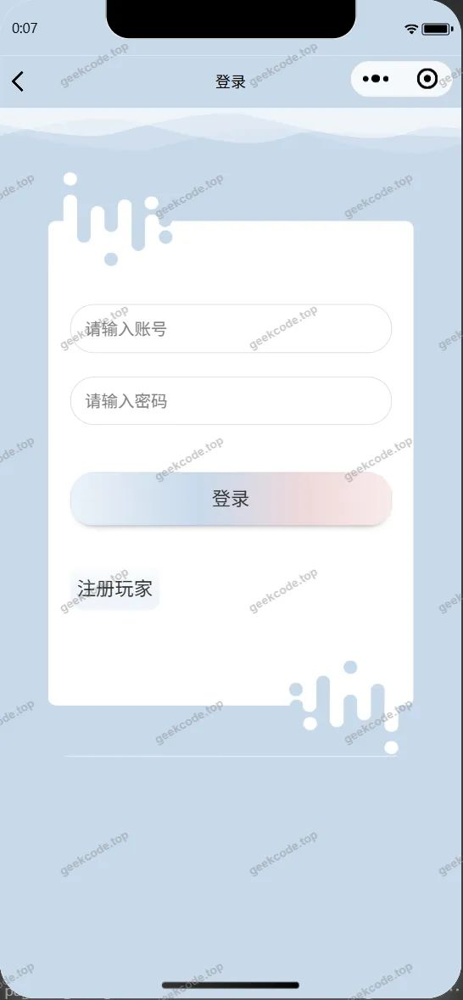</a><figcaption>小程序-登录</figcaption></figure>
<figure><a href="https://geekcode.top/archives/%E4%BD%BF%E5%91%BD%E5%8F%AC%E5%94%A4%E6%B8%B8%E6%88%8F%E5%8A%A9%E6%89%8B%E7%9A%84%E8%AE%BE%E8%AE%A1%E4%B8%8E%E5%AE%9E%E7%8E%B0pzbe0-%E8%AE%BA%E6%96%87?utm_source=github" title="查看完整源码">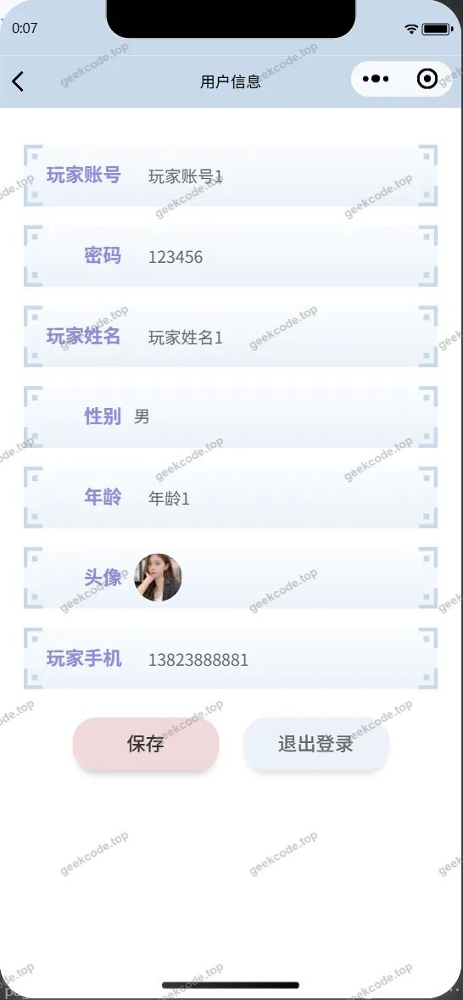</a><figcaption>小程序-个人信息</figcaption></figure>
<figure><a href="https://geekcode.top/archives/%E4%BD%BF%E5%91%BD%E5%8F%AC%E5%94%A4%E6%B8%B8%E6%88%8F%E5%8A%A9%E6%89%8B%E7%9A%84%E8%AE%BE%E8%AE%A1%E4%B8%8E%E5%AE%9E%E7%8E%B0pzbe0-%E8%AE%BA%E6%96%87?utm_source=github" title="查看完整源码">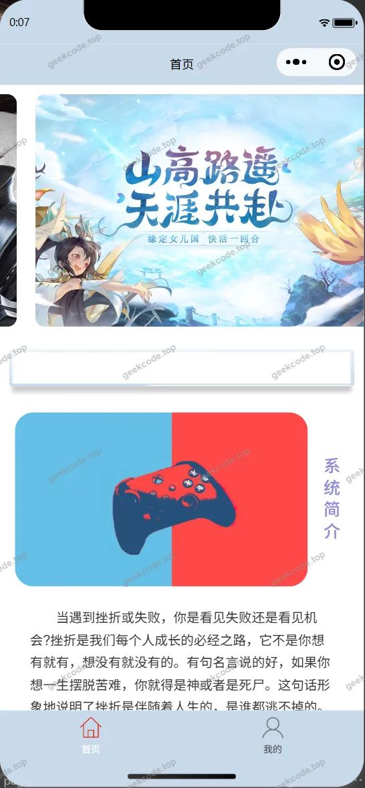</a><figcaption>小程序-首页</figcaption></figure>
<figure><a href="https://geekcode.top/archives/%E4%BD%BF%E5%91%BD%E5%8F%AC%E5%94%A4%E6%B8%B8%E6%88%8F%E5%8A%A9%E6%89%8B%E7%9A%84%E8%AE%BE%E8%AE%A1%E4%B8%8E%E5%AE%9E%E7%8E%B0pzbe0-%E8%AE%BA%E6%96%87?utm_source=github" title="查看完整源码">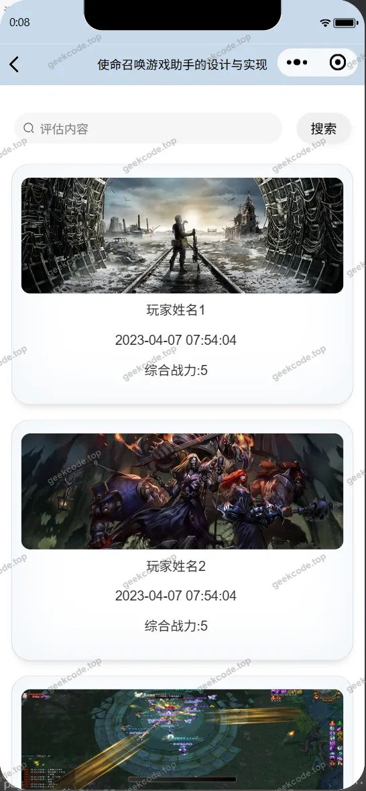</a><figcaption>小程序-水平评估列表</figcaption></figure>
<figure><a href="https://geekcode.top/archives/%E4%BD%BF%E5%91%BD%E5%8F%AC%E5%94%A4%E6%B8%B8%E6%88%8F%E5%8A%A9%E6%89%8B%E7%9A%84%E8%AE%BE%E8%AE%A1%E4%B8%8E%E5%AE%9E%E7%8E%B0pzbe0-%E8%AE%BA%E6%96%87?utm_source=github" title="查看完整源码">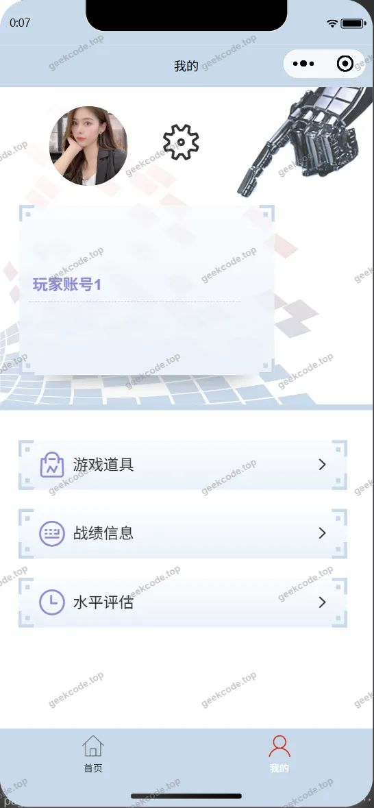</a><figcaption>小程序-我的</figcaption></figure>
<figure><a href="https://geekcode.top/archives/%E4%BD%BF%E5%91%BD%E5%8F%AC%E5%94%A4%E6%B8%B8%E6%88%8F%E5%8A%A9%E6%89%8B%E7%9A%84%E8%AE%BE%E8%AE%A1%E4%B8%8E%E5%AE%9E%E7%8E%B0pzbe0-%E8%AE%BA%E6%96%87?utm_source=github" title="查看完整源码">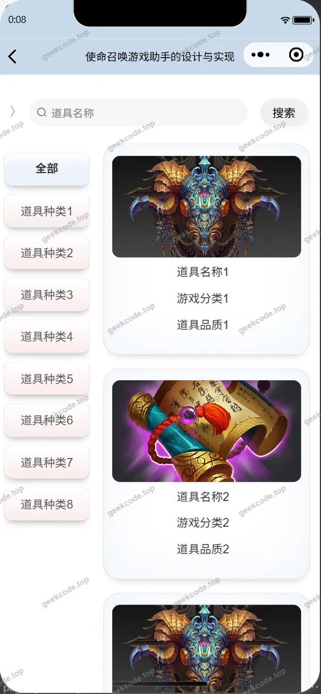</a><figcaption>小程序-游戏道具列表</figcaption></figure>
<figure><a href="https://geekcode.top/archives/%E4%BD%BF%E5%91%BD%E5%8F%AC%E5%94%A4%E6%B8%B8%E6%88%8F%E5%8A%A9%E6%89%8B%E7%9A%84%E8%AE%BE%E8%AE%A1%E4%B8%8E%E5%AE%9E%E7%8E%B0pzbe0-%E8%AE%BA%E6%96%87?utm_source=github" title="查看完整源码">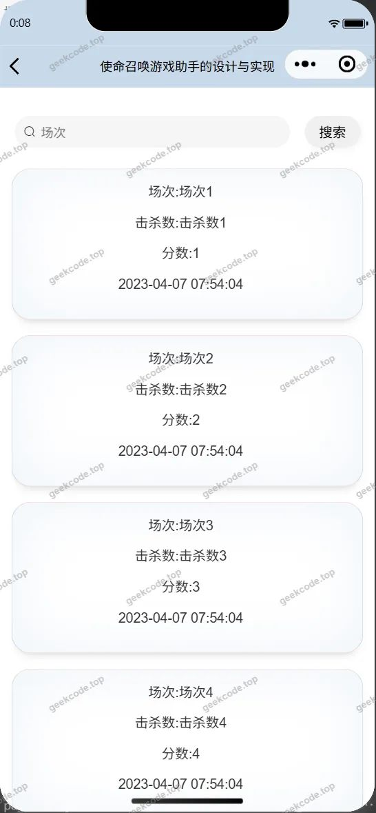</a><figcaption>小程序-战绩信息列表</figcaption></figure>
<figure><a href="https://geekcode.top/archives/%E4%BD%BF%E5%91%BD%E5%8F%AC%E5%94%A4%E6%B8%B8%E6%88%8F%E5%8A%A9%E6%89%8B%E7%9A%84%E8%AE%BE%E8%AE%A1%E4%B8%8E%E5%AE%9E%E7%8E%B0pzbe0-%E8%AE%BA%E6%96%87?utm_source=github" title="查看完整源码">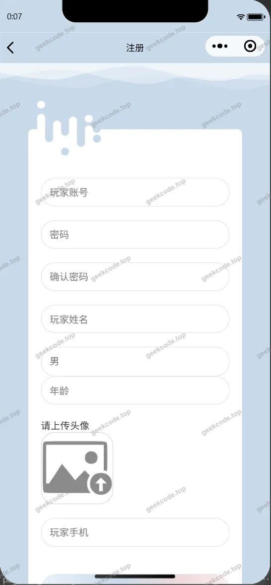</a><figcaption>小程序-注册</figcaption></figure>

<h3>微信小程序管理端</h3>

<figure><a href="https://geekcode.top/archives/%E4%BD%BF%E5%91%BD%E5%8F%AC%E5%94%A4%E6%B8%B8%E6%88%8F%E5%8A%A9%E6%89%8B%E7%9A%84%E8%AE%BE%E8%AE%A1%E4%B8%8E%E5%AE%9E%E7%8E%B0pzbe0-%E8%AE%BA%E6%96%87?utm_source=github" title="查看完整源码">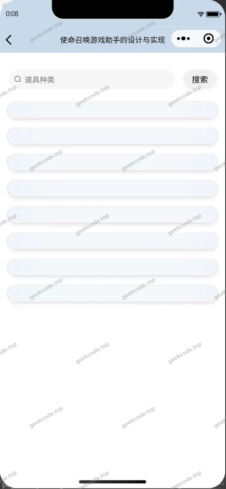</a><figcaption>小程序-管理端-道具种类列表</figcaption></figure>
<figure><figcaption>小程序-管理端-关于我们列表</figcaption></figure>
<figure><figcaption>小程序-管理端-玩家列表</figcaption></figure>
<figure><figcaption>小程序-管理端-系统简介列表</figcaption></figure>
<figure><figcaption>小程序-管理端-游戏分类列表</figcaption></figure>
<figure><a href="https://geekcode.top/archives/%E4%BD%BF%E5%91%BD%E5%8F%AC%E5%94%A4%E6%B8%B8%E6%88%8F%E5%8A%A9%E6%89%8B%E7%9A%84%E8%AE%BE%E8%AE%A1%E4%B8%8E%E5%AE%9E%E7%8E%B0pzbe0-%E8%AE%BA%E6%96%87?utm_source=github" title="查看完整源码">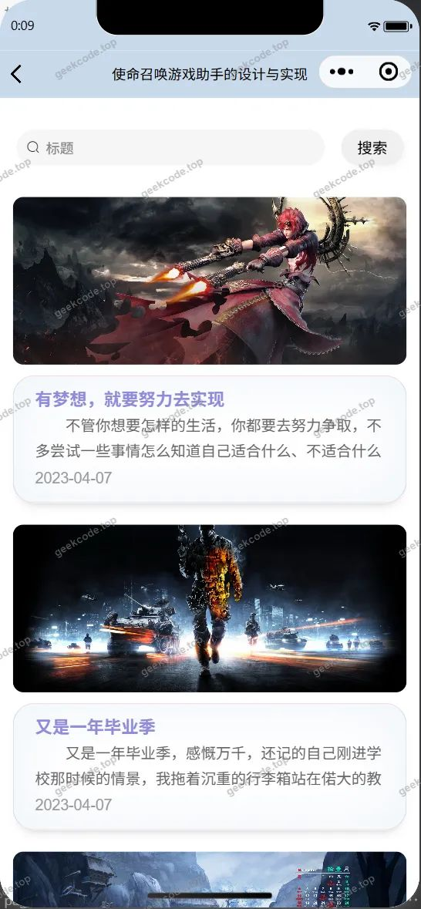</a><figcaption>小程序-管理端-游戏资讯列表</figcaption></figure>

<h3>后台管理端</h3>
<h4>后台-道具种类</h4>

<h4>后台-登录页</h4>

<h4>后台-关于我们</h4>

<a href="https://geekcode.top/archives/%E4%BD%BF%E5%91%BD%E5%8F%AC%E5%94%A4%E6%B8%B8%E6%88%8F%E5%8A%A9%E6%89%8B%E7%9A%84%E8%AE%BE%E8%AE%A1%E4%B8%8E%E5%AE%9E%E7%8E%B0pzbe0-%E8%AE%BA%E6%96%87?utm_source=github" title="查看完整源码">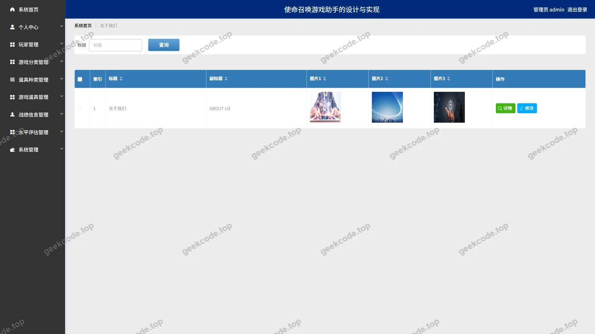</a>

<h4>后台首页</h4>

<a href="https://geekcode.top/archives/%E4%BD%BF%E5%91%BD%E5%8F%AC%E5%94%A4%E6%B8%B8%E6%88%8F%E5%8A%A9%E6%89%8B%E7%9A%84%E8%AE%BE%E8%AE%A1%E4%B8%8E%E5%AE%9E%E7%8E%B0pzbe0-%E8%AE%BA%E6%96%87?utm_source=github" title="查看完整源码">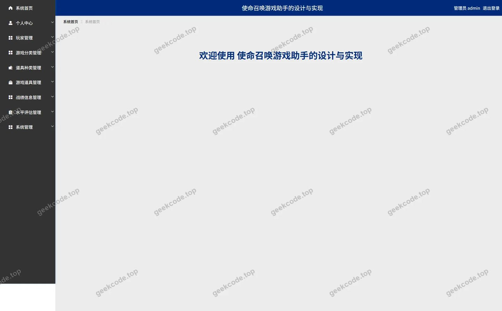</a>

<h4>后台-水平评估</h4>

<a href="https://geekcode.top/archives/%E4%BD%BF%E5%91%BD%E5%8F%AC%E5%94%A4%E6%B8%B8%E6%88%8F%E5%8A%A9%E6%89%8B%E7%9A%84%E8%AE%BE%E8%AE%A1%E4%B8%8E%E5%AE%9E%E7%8E%B0pzbe0-%E8%AE%BA%E6%96%87?utm_source=github" title="查看完整源码">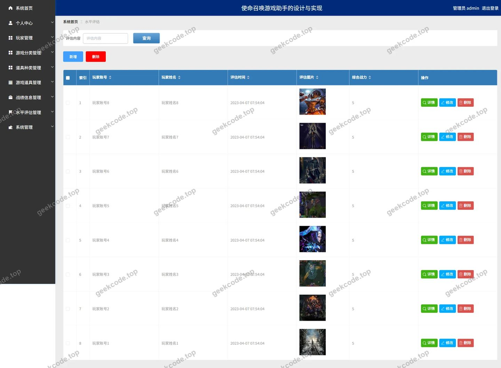</a>

<h4>后台-游戏分类</h4>

<a href="https://geekcode.top/archives/%E4%BD%BF%E5%91%BD%E5%8F%AC%E5%94%A4%E6%B8%B8%E6%88%8F%E5%8A%A9%E6%89%8B%E7%9A%84%E8%AE%BE%E8%AE%A1%E4%B8%8E%E5%AE%9E%E7%8E%B0pzbe0-%E8%AE%BA%E6%96%87?utm_source=github" title="查看完整源码">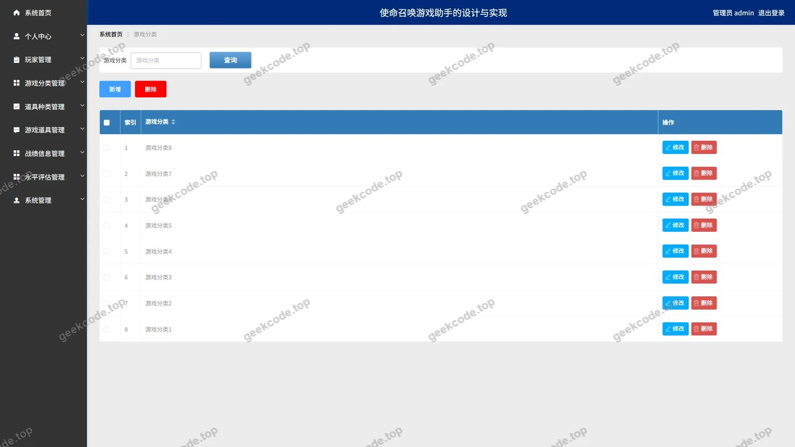</a>

<h4>后台-游戏资讯</h4>

<a href="https://geekcode.top/archives/%E4%BD%BF%E5%91%BD%E5%8F%AC%E5%94%A4%E6%B8%B8%E6%88%8F%E5%8A%A9%E6%89%8B%E7%9A%84%E8%AE%BE%E8%AE%A1%E4%B8%8E%E5%AE%9E%E7%8E%B0pzbe0-%E8%AE%BA%E6%96%87?utm_source=github" title="查看完整源码">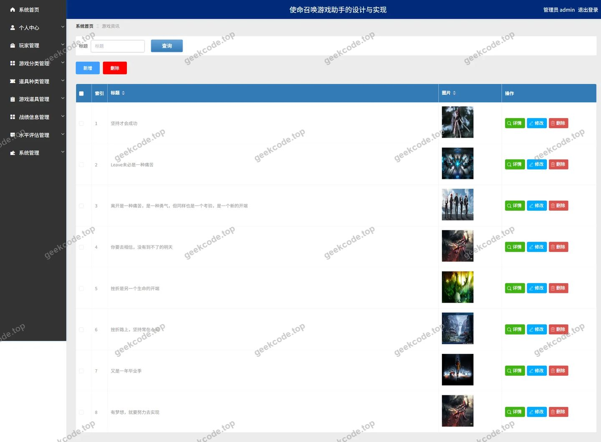</a>

<h4>后台-战绩信息</h4>

<a href="https://geekcode.top/archives/%E4%BD%BF%E5%91%BD%E5%8F%AC%E5%94%A4%E6%B8%B8%E6%88%8F%E5%8A%A9%E6%89%8B%E7%9A%84%E8%AE%BE%E8%AE%A1%E4%B8%8E%E5%AE%9E%E7%8E%B0pzbe0-%E8%AE%BA%E6%96%87?utm_source=github" title="查看完整源码">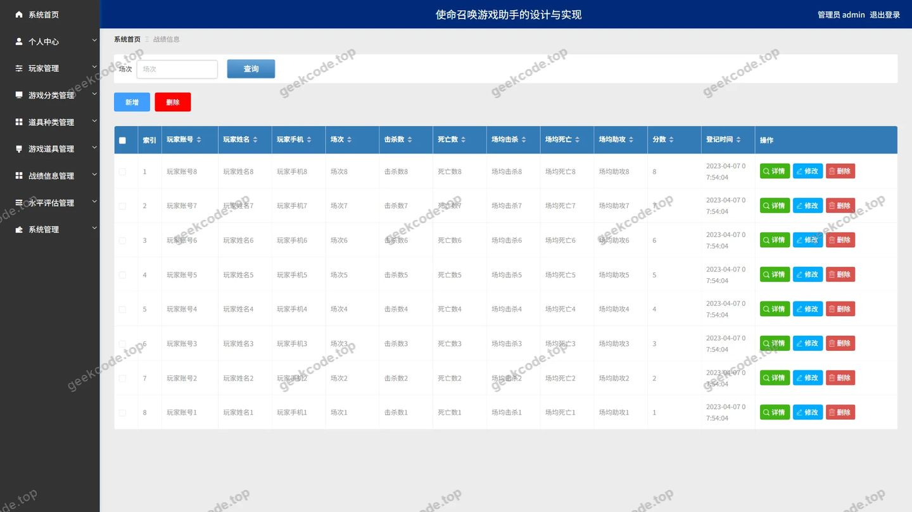</a>

---

## 获取完整源码

| 项目 | 说明 |
| --- | --- |
| 项目名 | 使命召唤游戏助手的设计与实现pzbe0--论文 |
| 运行截图 | 本文 22 张（站点带水印原图，仓库 `images/` 目录） |
| 完整源码 | [https://geekcode.top/archives/%E4%BD%BF%E5%91%BD%E5%8F%AC%E5%94%A4%E6%B8%B8%E6%88%8F%E5%8A%A9%E6%89%8B%E7%9A%84%E8%AE%BE%E8%AE%A1%E4%B8%8E%E5%AE%9E%E7%8E%B0pzbe0-%E8%AE%BA%E6%96%87?utm_source=github](https://geekcode.top/archives/%E4%BD%BF%E5%91%BD%E5%8F%AC%E5%94%A4%E6%B8%B8%E6%88%8F%E5%8A%A9%E6%89%8B%E7%9A%84%E8%AE%BE%E8%AE%A1%E4%B8%8E%E5%AE%9E%E7%8E%B0pzbe0-%E8%AE%BA%E6%96%87?utm_source=github) |
| 咨询微信 | **ir9372**（备注：jingpin-yuanma） |
| 更多项目 | [极客代码 geekcode.top](https://geekcode.top/?utm_source=github) |

> 需要源码、部署、改配置、跑不起来等问题，加微信 ir9372 沟通，说明项目名即可。
